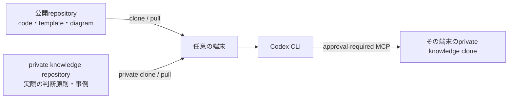

# my-thinking-agent

English: [README.md](README.md).

my-thinking-agent は、Codexを個人向けの**判断支援役**として使うためのローカル優先projectです。判断原則、privateな過去事例、会話からreviewした学びを基に、選択肢・不確実性・次の確認事項を整理します。

本人を完全に再現したり、自律的に判断・発信したりするものではありません。MCPはprivate knowledge内の判断記録を作成・更新・archive・復元できますが、各操作には明示承認と完全一致confirmationが必要です。message送信、外部serviceの変更、Git commit/push、完全消去はできません。

## まずこれだけ

初めて使う場合は、次の順に入力します。設定は質問に答えながら進められます。

~~~bash
cd ~/my-thinking-agent
make doctor
make start
~~~

準備が終わったら、`my-thinking-agent`をcloneしたproject folder（例: `~/my-thinking-agent`）で`codex`を起動します。source folderやprivate repositoryのfolderではありません。より丁寧な手順は[はじめて使う](docs/first-steps.ja.md)を参照してください。

~~~text
Codex CLI
  ├─ AGENTS.md                         常に守る運用境界
  ├─ knowledge/decision-principles.md  簡潔で長期的な判断原則
  └─ personal-knowledge MCP            事例の検索・承認付きCRUD（任意で接続）
~~~

## 利用と同期のflow



公開repositoryとprivate knowledge repositoryを分けることで、同じ構成を複数端末で再現しつつ、実際の判断記録を公開sourceから隔離します。[仕組みの概要](docs/overview.ja.md)で、component、情報境界、record変更から端末同期までのMermaid diagramを確認できます。端末の追加方法と同期手順は[複数端末での利用と同期](docs/portable-setup.ja.md)を参照してください。

`my-thinking-agent-private` はprivate knowledge repositoryの推奨名です。架空sampleだけを試す場合や、同期しない単一端末の試用では不要です。一方、実際の判断原則・記録を複数端末で安全に同期する場合は必要です。新規作成する場合を含む選び方は[private knowledge repositoryは必要か](docs/portable-setup.ja.md#private-knowledge-repositoryは必要か)に記載しています。

## 具体例から始める

実際の個人情報を入力せずに、検索から作成・更新・archive・復元・端末間同期までを試せる[段階的tutorial](docs/tutorials.ja.md)を用意しています。題材は架空のproject優先順位です。

- [MCP toolごとの引数例](examples/mcp-tool-calls.md) — Codexに渡す依頼文と、serverが受け取る引数の対応
- [架空の判断記録sample](examples/tutorial-project-priority.md) — Create / Updateで使う完全なMarkdown
- [会話からの学習とopt-in source](docs/conversation-learning.ja.md) — 手入力なしの学習候補、質問、source rootの設定
- [更新・同期・設定](docs/update-operations.ja.md) — どの更新が自動か、端末ごとに必要な設定、JJでの反映手順

## 対話的な初期設定・端末引継ぎ

READMEを読み返さずにprivate rootを接続したい場合は、次を実行します。

```bash
cd ~/my-thinking-agent
make onboard
```

選択肢から、単一端末のlocal private root、既存private repositoryのcloneを含む別端末引継ぎ、新しいprivate GitHub repositoryの作成を選べます。repository作成、clone、initial templateのpushは対象を表示し、`CREATE PRIVATE REPOSITORY`などの完全一致confirmationを入力した場合だけ実行されます。判断recordを自動でuploadしたり、MCPのapprovalを緩和したりはしません。

現在の端末の設定だけを安全に確認する場合:

```bash
make onboard-status
```

詳しい選択肢とconfirmationは[対話的onboarding](docs/onboarding.ja.md)を参照してください。

sampleは説明用です。実際の判断記録はpublic repositoryへcopyせず、private knowledge repositoryだけに保存してください。公開された[private repository template](templates/my-thinking-agent-private/)には実データを入れていません。`make onboard`の選択肢3は、完全一致confirmation後だけ、このtemplateから新しいprivate remoteを作成します。

### 1. 判断原則と事例を用意する

knowledge/decision-principles.md には、複数の課題に共通する判断基準だけを記載します。具体的な事例は knowledge/templates/decision.md をcopyして knowledge/decisions/ に1件ずつ保存してください。

新しい判断記録と knowledge/private/ はGitの追跡対象外です。password、API key、私的な会話、顧客名をrepositoryへ置かないでください。

各事例は次のfront matterを必須とします。

~~~md
---
id: vendor-selection-2026-01
title: 長期保守を考慮した委託先選定
date: 2026-01-15
classification: internal
tags: 委託, リスク, 保守
---
~~~

classification は public、internal、confidential のいずれかです。分類がない事例は拒否されます。既定でMCPが返すのは internal までであり、confidential を日常の対話へ渡しません。

### 2. まずMCPなしで評価する

~~~bash
cd ~/my-thinking-agent
codex
~~~

~~~text
knowledge/decision-principles.md と、架空のsample事例だけを読んでください。
以下の判断をreviewし、事実・仮定・選択肢・推奨・実行前に確認すべき事項を分けてください。
外部toolの利用とfile変更は行わないでください。
~~~

この段階で、判断原則の表現と回答の安全性を調整します。

### 3. ローカルknowledge MCPをtestする

Python 3.11以上だけで動きます。

~~~bash
make test
make mcp
~~~

make mcp はCodexから起動するためのstdio JSON-RPC serverです。提供するtoolは次のとおりです。

- list_principles、search_decisions、read_decision — 判断原則・許可済み事例を取得する
- create_decision、update_decision — 明示承認後に事例を作成・更新する
- delete_decision — 明示承認後に事例を `.trash` へarchiveする
- list_archived_decisions、restore_decision — archive済み事例を確認・復元する
- list_learning_sources、search_learning_sources、read_learning_source — opt-inしたworkspace配下の学習sourceを限定的に参照する
- prepare_conversation_learning、save_conversation_learning — 会話の要約から質問またはreview用draftを作り、明示confirmation後にprivate recordへ保存する

操作別のconfirmation、削除・復元、JJ Pull Requestによる他端末への同期は[判断記録のCRUDと同期](docs/crud-operations.ja.md)を参照してください。会話からの学習とsource rootの設定は[会話からの学習](docs/conversation-learning.ja.md)を参照してください。

### 4. CodexでMCPを使う

`make start`または`make onboard`が、このproject用のlocal MCP設定を作ります。手でMCP設定を登録する必要はありません。設定後は`my-thinking-agent`のproject folderで`make mcp-status`を実行し、`personal-knowledge`と有効toolを確認してからCodexを起動します。

~~~bash
cd ~/my-thinking-agent
make mcp-status
codex
~~~

~~~text
personal-knowledgeを使い、「可逆性」と「外部公開」に関する事例だけを検索してください。
推奨を出す前に、参照した事例IDと、その事例を使える理由・使えない理由を示してください。
file変更は行わないでください。
~~~

`config/codex-mcp-config.toml.example`は仕組みを確認するためのsampleです。実際の`.codex/`設定は端末固有でGitから除外されます。日常利用では、`make start`が作る既定の情報境界を変更しないでください。

## 構成と情報保護

| path | 用途 | Gitの扱い |
| --- | --- | --- |
| AGENTS.md | Codexが守る安全・運用rule | 追跡 |
| knowledge/decision-principles.md | 一般化した判断profile | 追跡 |
| knowledge/decisions/ | 具体的な判断事例 | 新規fileは除外 |
| knowledge/private/ | 通常検索に渡さない資料 | 除外 |
| src/my_thinking_agent/ | 承認付きCRUD対応MCP server | 追跡 |
| prompts/ | 再利用する人向けprompt | 追跡 |

serverは knowledge/decisions/ 外のpath、無効なID、未知の分類を拒否します。書き込みはprivate knowledge内のrecordに限定し、操作ごとの明示confirmationなしには実行しません。email、calendar、chat、GitHubなどへ接続するのは、判断記録CRUDの評価が完了してからにしてください。

## 評価の進め方

匿名化した判断事例を10〜20件追加し、答えが分かっている課題で評価します。根拠選択、判断原則への忠実性、不確実性の扱い、実用性を確認してください。同じ修正が繰り返される場合だけ判断原則へ一般化して追記し、詳細な理由は個別の判断記録に残します。

## command

~~~bash
make doctor  # 必要なcommandを確認。設定変更なし
make start   # 初めて使う人向けの順番案内
make status  # この端末の設定・MCP・sourceをまとめて表示
make onboard # 初回設定・別端末設定を直接選ぶ
make onboard-status # 現在の端末の設定状態を表示
make mcp-status # Codexに登録されたMCPと有効toolを表示
make private-list # private recordのfile名を一覧。本文は表示しない
make test  # unit testとJSON-RPC protocol test
make help  # command一覧を表示
make repl  # 設定・learning sourceを対話管理
make update-mcp                                             # configからprivate rootを読み、生成済みlocal MCP設定を更新
make learning-add SOURCE=kvnc=../kvnc                       # sourceを追加または更新
make learning-sources                                       # sourceと利用可否を表示
make learning-remove SOURCE=kvnc                            # sourceを削除
make mcp   # 上級者用: ローカルstdio MCP serverを直接起動
make private-init KNOWLEDGE_ROOT=/path/to/private-knowledge  # 上級者用: private rootを空のdirectoryに初期化
make configure-mcp KNOWLEDGE_ROOT=/path/to/private-knowledge # 上級者用: この端末だけのMCP設定を生成
~~~

非対話で読み取り専用reviewを行う場合:

~~~bash
codex exec --sandbox read-only \
  "AGENTS.mdとknowledge/decision-principles.mdを読み、この提案をreviewしてください。MCPは使わず、fileを変更しないでください。"
~~~

## 公式document

- [Codexのcustomization（AGENTS.md、skills、MCP）](https://learn.chatgpt.com/docs/customization/overview)
- [CodexのMCP設定](https://learn.chatgpt.com/docs/extend/mcp)
- [Codex CLI](https://learn.chatgpt.com/docs/codex/cli)
