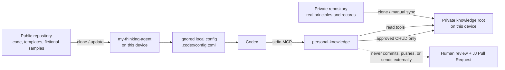

# my-thinking-agent

Japanese: [README.ja.md](README.ja.md).

my-thinking-agent is a local-first project for using Codex as a personal
decision-support assistant. It organizes options, uncertainty, and next checks
from decision principles, private precedents, and reviewed learning derived
from conversations.

It does not impersonate you, decide autonomously, or send messages on your
behalf. The MCP server can create, update, archive, and restore private decision
records only after explicit approval and an exact confirmation phrase. It cannot
send data externally, commit or push Git/JJ changes, or permanently erase data.

## How it works



The public project and private knowledge are deliberately separate. See the
[architecture overview](docs/overview.md) for the trust boundary and the full
record-change lifecycle.

## Start safely

For a first use, start with the step-by-step guide:

```bash
cd ~/my-thinking-agent
make start
```

It guides one local device at a time and does not publish anything or register
a source folder without your selection. See [first steps](docs/first-steps.md).

The existing device configuration can be inspected without changing files:

```bash
cd ~/my-thinking-agent
make onboard-status
```

To set up a new device or connect a private root interactively:

```bash
make onboard
```

The command shows the target and requests an exact confirmation before it
initializes a private root, clones a repository, creates a GitHub repository, or
pushes an initial template. It never uploads a decision record automatically.
See [interactive onboarding](docs/onboarding.md).

## Use the MCP

From the project directory, run `make mcp-status` to confirm that Codex has
registered `personal-knowledge` and its enabled tools. Then start Codex:

```bash
cd ~/my-thinking-agent
make mcp-status
codex
```

Read tools (`list_principles`, `search_decisions`, `read_decision`) do not
modify the private root. Conversation learning uses explicit local source roots
and turns Codex's summary of a request, outcome, and user feedback into a draft;
the MCP asks for only missing information. Saving still requires the returned
exact `SAVE LEARNING <id>` phrase. See [conversation-derived
learning](docs/conversation-learning.md) and [decision-record CRUD and
synchronization](docs/crud-operations.md).

## Guides

- [Architecture overview](docs/overview.md)
- [First steps](docs/first-steps.md)
- [Conversation-derived learning and opted-in sources](docs/conversation-learning.md)
- [Interactive onboarding](docs/onboarding.md)
- [Portable setup and multi-device synchronization](docs/portable-setup.md)
- [Decision-record CRUD and synchronization](docs/crud-operations.md)
- [Fictional-data tutorial](docs/tutorials.md)
- [Updates, synchronization, and configuration](docs/update-operations.md)

## Fictional samples and evaluation

Start with the [fictional tutorial](docs/tutorials.md) and do not place real
personal, customer, credential, or confidential information in this public
repository. The public [private-repository template](templates/my-thinking-agent-private/)
contains no real records; `make onboard` option 3 can create a private remote
from that template only after exact confirmation.

## Commands

```bash
make doctor
make start
make status
make onboard
make onboard-status
make mcp-status
make private-list
make test
make help
make mcp
make repl
make private-init KNOWLEDGE_ROOT=/path/to/private-knowledge
make configure-mcp KNOWLEDGE_ROOT=/path/to/private-knowledge
make update-mcp
make learning-add SOURCE=kvnc=../kvnc
make learning-sources
make learning-remove SOURCE=kvnc
```

## Official documentation

- [Codex customization: AGENTS.md, skills, and MCP](https://learn.chatgpt.com/docs/customization/overview)
- [Codex MCP configuration](https://learn.chatgpt.com/docs/extend/mcp)
- [Codex CLI](https://learn.chatgpt.com/docs/codex/cli)
