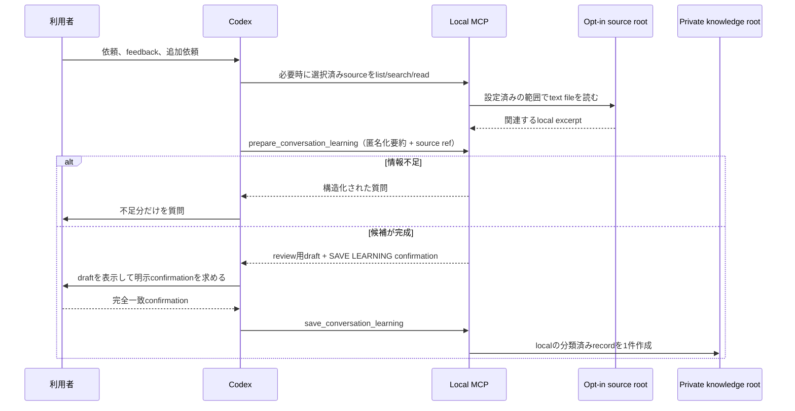

# 会話からの学習

English: [conversation-learning.md](conversation-learning.md).

`my-thinking-agent` は、完了した会話を簡潔な private learning record にできます。利用者がMarkdown recordを手入力する必要はありません。Codexが依頼、回答・実施結果、利用者からの訂正または追加依頼を要約し、MCPが不足情報だけを質問してreview可能なdraftを作ります。

これはmodel weightの学習ではなく、localな検索・記憶です。stdio MCPにはterminal、別のCodex session、chat transcriptを受動的に傍受する機能はありません。Codexが明示的に渡したtool引数だけを扱います。background監視は行わず、端末ごとに明示設定したsource root以外は読みません。

## Codex workspaceごとのsource rootをopt-inする

対象にするworkspaceへ短い名前を付けます。commandではrelative pathも指定でき、`--project-root`（既定では現在の`my-thinking-agent` checkout）を基準に解決されます。解決後のabsolute pathだけがignoreされたlocalの`.codex/config.toml`に保存され、Gitやprivate knowledge repositoryには同期されません。

初回設定は、質問に答えるだけの案内を使います。この端末用のignoreされたlocal設定が作られます。

```bash
cd ~/my-thinking-agent
make start
```

案内でsource folderを聞かれたときは、最初は`N`と答えて大丈夫です。後から追加できます。長いpathを含むcommandを覚える必要はありません。

初回設定の後にsourceを追加・確認・削除する場合は、簡単なmenuを開きます。

```bash
make repl
```

`4`を選び、短い名前（例: `kvnc`）と`../kvnc`のようなpathを入力します。複数追加する場合は、`4`を必要な回数だけ選びます。`3`で一覧、`5`で削除できます。1行で操作したい場合は、`make learning-add SOURCE=kvnc=../kvnc`のようにsourceごとに繰り返し、`make learning-sources`、`make learning-remove SOURCE=kvnc`も使えます。これらは`.codex/config.toml`からprivate rootのpathを読み、pathを推測せずに停止します。

MCPが読むのは指定root配下の`.md`、`.txt`、`.log`だけです。`.git`、`.jj`、`.codex`、`.venv`、`node_modules`、`build`、`dist`などのhidden metadata・generated directoryは除外し、file数・file sizeにも上限を設けます。

source rootはcloneする`my-thinking-agent-private`には含まれず、端末固有の設定です。WindowsとmacOSではclone後にそれぞれのpathを設定してください。新たに指定するpathはその端末で存在している必要があり、存在しなければ設定commandは安全に停止します。すでに設定済みのrootが後からなくなった場合、`list_learning_sources`は利用不可として表示し、全source検索ではそのrootをskipします。一方で利用不可のsourceを名前で明示検索した場合は、別pathを読むことなく利用不可errorを返します。

## 秘書型の学習flow



`prepare_conversation_learning` は、依頼要約、assistant outcome、利用者feedback、長期的に残す学びのいずれかが不足すると質問を返します。書き込みはしません。Codexが長期的な学び、適用するsource、または一貫した判断基準を確定できない場合は、保存候補を作らずに要点を絞って再質問します。通常のflowは次のとおりです。

1. Codexが現在の会話から要約し、利用者にrecord templateを書かせません。
2. 必要な場合だけopt-in済みsource rootを検索し、候補に相対pathを付けます。
3. MCPが不足質問または完全なdraftを返します。
4. Codexがdraftを表示します。返された`SAVE LEARNING <id>`を明示した場合だけ、現在の端末のprivate rootへ保存します。

生のprompt・生の回答・credential・key・個人を直接識別できる情報ではなく、匿名化済みの短い要約を保存してください。source refは保存時にも再検証するため、opt-inしていないroot外のpathは使えません。

## 再利用と安全性

以後の会話では、`search_decisions`で関連recordを検索してから全文を読みます。recordの`Summary`が類似判断の先例になります。source file自体はlocalに残り、learning recordにはreviewした要約と相対source refだけを残します。

以後の実質的な依頼では、Codexが推奨を出す前に類似recordを検索します。これにより検索、判断基準との整合確認、次の手順の提案を自動化しますが、行為そのものを自律実行するものではありません。類似先例がない場合やsourceが矛盾する場合は、その不在・矛盾を示し、過去の回答が適用できるように装わず要点を絞って質問します。

学習recordは行為の権限にはなりません。削除・archive・外部送信・公開・credential変更・支出・契約・その他の不可逆操作は、対象を示す別の明示指示が必要です。MCPによる保存もlocalだけです。commit、push、Pull Request作成、外部送信は行いません。

## private repository template

公開された[private repository template](../templates/my-thinking-agent-private/)は、private companion repositoryを再現するデータなしのsampleです。`make onboard`の選択肢3は、既定で`my-thinking-agent-private`という新しいprivate GitHub repositoryを作成できますが、完全一致confirmation後だけです。通常の初期設定で自動作成されるわけではありません。[対話的onboarding](onboarding.ja.md)と[複数端末での利用と同期](portable-setup.ja.md)も参照してください。
