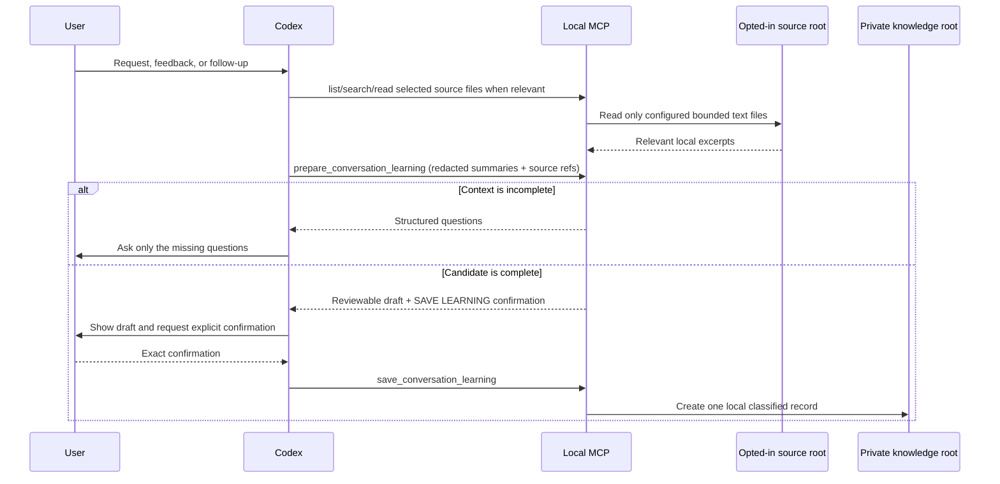

# Conversation-derived learning

Japanese: [conversation-learning.ja.md](conversation-learning.ja.md).

`my-thinking-agent` can turn a completed conversation into a concise private
learning record. The user does not have to write a Markdown record by hand:
Codex summarizes the request, its outcome, and the user's correction or
follow-up; the MCP validates the information, asks only for missing context,
and prepares a reviewable draft.

This is local retrieval and memory, not model-weight training. A stdio MCP has
no ability to passively observe a terminal, another Codex session, or a chat
transcript. It sees only tool arguments that Codex deliberately sends. There is
no background monitoring and no source root is read until it is explicitly
configured on that device.

## Opt in source roots per Codex workspace

Give each selected workspace a short name. Absolute paths are stored only in
the ignored local `.codex/config.toml`; they are not put in Git or synchronized
with the private knowledge repository. You can enter a relative path on the
command line; it is resolved from `--project-root` (the current
`my-thinking-agent` checkout by default) and then stored as an absolute path.

For a first configuration, use the guided setup. It asks only the necessary
questions and creates this device's ignored local configuration:

```bash
cd ~/my-thinking-agent
make start
```

When the guide asks about a source folder, answering `N` is safe. You can add
one later. This is usually easier than entering a long command with paths.

After the first setup, open the simple menu to add, view, or remove a source:

```bash
make repl
```

Choose `4`, enter a short name such as `kvnc`, then enter its path such as
`../kvnc`. Choose `4` again for each additional folder. Choose `3` to check
the registered folders and `5` to remove one.
`make learning-add SOURCE=kvnc=../kvnc`, `make learning-sources`, and
`make learning-remove SOURCE=kvnc` remain available for people who prefer
one-line commands. These commands read the private-root path from
`.codex/config.toml` and stop rather than guessing it.

The MCP reads only `.md`, `.txt`, and `.log` files beneath those roots. It skips
hidden metadata and common generated directories such as `.git`, `.jj`,
`.codex`, `.venv`, `node_modules`, `build`, and `dist`; reading and searching
are bounded by file-count and file-size limits.

Source roots belong to the device-local configuration, not to a cloned
`my-thinking-agent-private` repository. Configure Windows and macOS paths
independently after cloning. A newly supplied source path must exist on the
current device, so a configuration command fails safely if it does not. If a
previously configured root later disappears, `list_learning_sources` reports it
as unavailable and an all-source search skips it; an explicitly named search
returns an unavailable-source error instead of reading a different path.

## Secretary-style learning flow



`prepare_conversation_learning` returns questions for a missing request
summary, assistant outcome, user feedback, or durable learning. It does not
write anything. If Codex cannot determine the durable learning, applicable
source, or a consistent criterion, it asks a focused follow-up instead of
preparing or saving a record. The normal flow is:

1. Codex uses the current conversation; it does not ask the user to author a
   record template.
2. When relevant, it searches explicitly opted-in roots and cites selected
   relative source paths in the candidate.
3. The MCP returns only any missing questions, or a complete draft.
4. Codex shows the draft. Storage requires the returned exact
   `SAVE LEARNING <id>` confirmation and changes only the current device's
   private root.

Store concise, anonymized summaries, not raw prompts, raw responses,
credentials, keys, or directly identifying information. A source reference is
checked again when the draft is saved, so a path outside an opted-in root cannot
be used.

## Reuse and safety

Future conversations use `search_decisions` before full record reads, so the
record's `Summary` becomes a comparable precedent. The source files themselves
remain local; a learning record stores only the relative source reference and
the reviewed summary.

For a material future request, Codex searches comparable records before making
a recommendation. This automates retrieval, consistency checks, and a proposed
next step—not autonomous execution. If no comparable precedent exists or the
sources conflict, Codex says so and asks a focused question rather than
pretending that a prior answer applies.

Learning never authorizes action. Delete/archive, external sending,
publication, credential changes, spending, contracts, and other irreversible
operations require a separate, explicit user instruction that identifies the
target. MCP record creation also remains local-only: it never commits, pushes,
creates a Pull Request, or sends data externally.

## Private repository template

The public [private-repository template](../templates/my-thinking-agent-private/)
is a data-free example of the private companion repository. `make onboard`
option 3 can create a new private GitHub repository named
`my-thinking-agent-private` by default, but only after exact confirmation; it
does not create one automatically during ordinary setup. See [interactive
onboarding](onboarding.md) and [portable setup](portable-setup.md).
