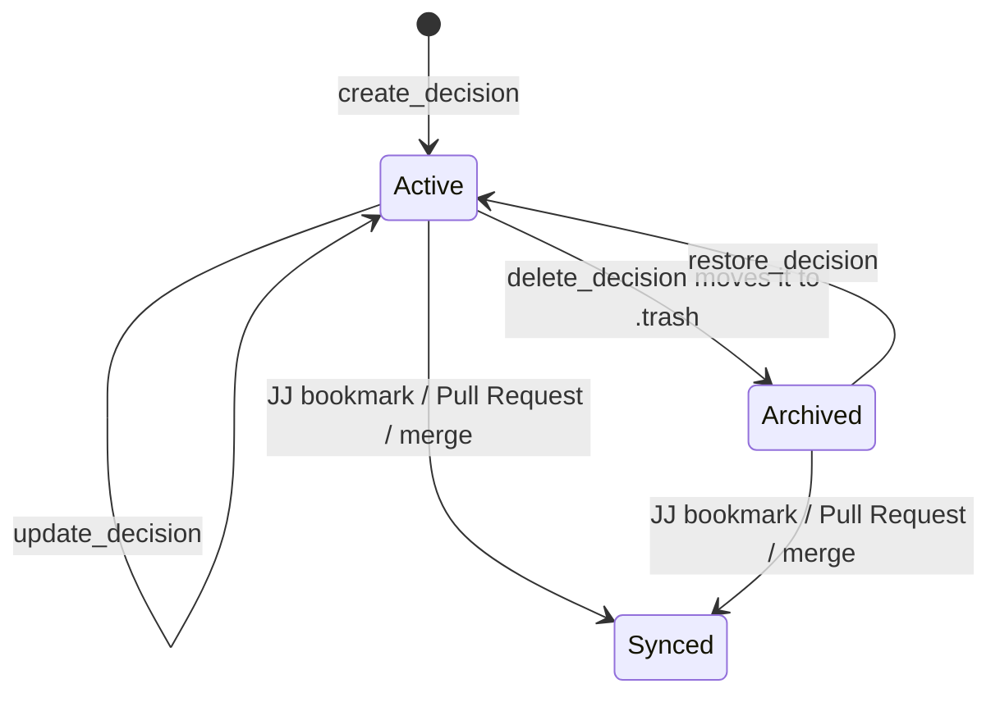
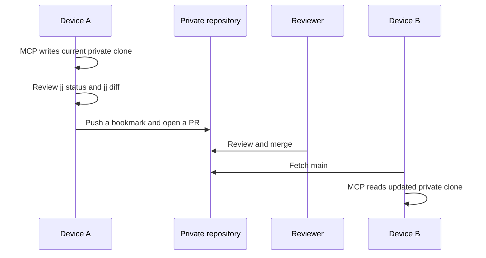

# Decision-record CRUD and synchronization

Japanese: [crud-operations.ja.md](crud-operations.ja.md).

Store real decision records only in the private knowledge repository. MCP
changes only this device's private clone; it never commits, pushes, opens Pull
Requests, or sends data externally. Start with the fictional [tutorial](tutorials.md).

## Operation boundary



| Operation | MCP tool | Exact confirmation | Result |
| --- | --- | --- | --- |
| Create | `create_decision` | `CREATE <id>` | Creates a Markdown record |
| Read | `search_decisions` / `read_decision` | None | Returns permitted records |
| Update | `update_decision` | `UPDATE <id>` | Atomically replaces the complete same-ID record |
| Archive | `delete_decision` | `ARCHIVE <id>` | Moves the active record to `.trash` |
| Restore | `restore_decision` | `RESTORE <id>` | Returns a selected archive to active records |
| Prepare conversation learning | `prepare_conversation_learning` | None | Returns questions or an unsaved standardized draft |
| Save conversation learning | `save_conversation_learning` | `SAVE LEARNING <id>` | Creates one reviewed local record from the prepared fields |

Tool approval and the exact confirmation are two separate safeguards. MCP
writes and Git/JJ synchronization are separate manual operations.

Conversation-derived learning does not require a user to hand-author Markdown.
Codex summarizes the current request, result, and feedback, while the MCP asks
only for missing information and validates optional references to selected local
source roots. See [conversation-derived learning](conversation-learning.md).

## Create and update

Ask for a complete reviewable draft first. Authorize storage only after
reviewing it in the same conversation.

```text
Show a complete draft for private knowledge, including front matter. Do not save it yet.

(after review)
CREATE vendor-selection-2026-01
```

Each record needs `id`, `title`, `date`, and `classification` in front matter;
the front-matter ID must match its filename. Updates replace complete Markdown,
not patches, preserving a reviewable classification and summary.

```text
Read vendor-selection-2026-01 and show the complete revised record. Do not update it yet.

(after review)
UPDATE vendor-selection-2026-01
```

## Archive and restore

Archive is recoverable, not permanent deletion. `delete_decision` moves the
record to `.trash` and returns an `archive_id`. Use
`list_archived_decisions` before restoration; restoration refuses to overwrite
an active record.

```text
ARCHIVE vendor-selection-2026-01

# After confirming the returned archive_id
RESTORE vendor-selection-2026-01
```

Git history and backups may retain information even after removing `.trash` or
rewriting history. Do not store data that requires guaranteed legal erasure.

## Synchronize reviewed records



```bash
cd ~/my-thinking-agent-private
jj status
jj describe -m "knowledge: update vendor-selection-2026-01"
jj bookmark create knowledge/vendor-selection-2026-01 -r @
jj git push --bookmark knowledge/vendor-selection-2026-01
gh pr create --base main --head knowledge/vendor-selection-2026-01 \
  --title "knowledge: update vendor-selection decision record"
```

After merge, fetch the private repository on other devices before starting
Codex. Do not edit the same record concurrently; resolve and review Git/JJ
conflicts before further MCP writes.

## Update generated MCP configuration

Only a guided-setup-generated configuration can be updated automatically:

```bash
cd ~/my-thinking-agent
make update-mcp
```

This command reads the private-root path already created by `make start` or
`make onboard`. Hand-written `config.toml` is never overwritten. Compare it with
`config/codex-mcp-config.toml.example`, make deliberate changes, run
`make mcp-status`, and restart Codex.
