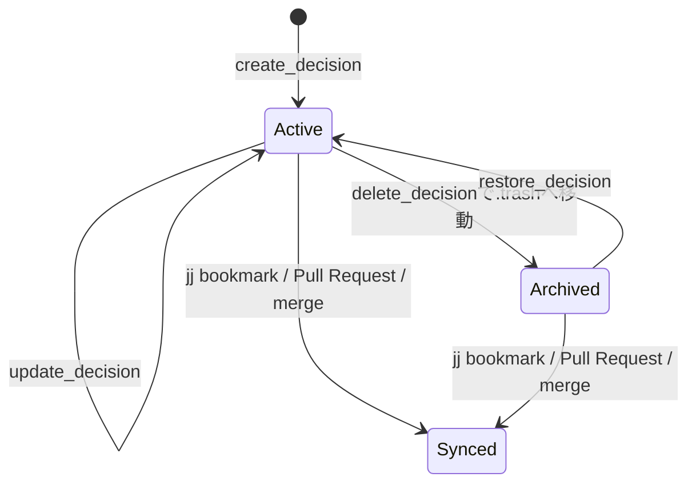
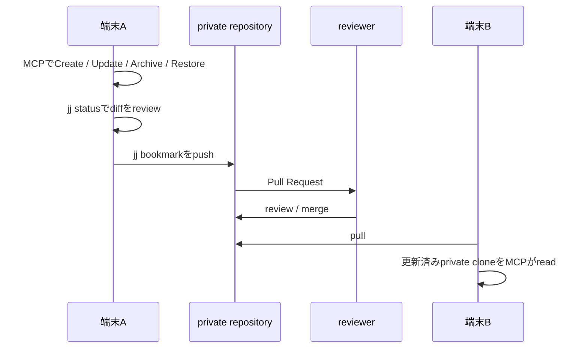

# 判断記録のCRUDと同期

判断記録はprivate knowledge repositoryだけに保存します。MCPは各端末のprivate cloneへ変更を反映しますが、Git commit、push、Pull Request、外部送信は行いません。

初めて操作する場合は、実データを使わない[実践tutorial](tutorials.md)で一連の操作を確認してから、この手順を適用してください。

## 操作の境界



| 操作 | MCP tool | 必須confirmation | 結果 |
| --- | --- | --- | --- |
| Create | create_decision | CREATE <id> | 新しいMarkdown recordを作成 |
| Read | search_decisions / read_decision | なし | 許可済み分類のrecordを取得 |
| Update | update_decision | UPDATE <id> | 同じIDのrecordをatomicに置換 |
| Delete | delete_decision | ARCHIVE <id> | active recordから除外し .trash へ移動 |
| Restore | restore_decision | RESTORE <id> | archiveをactive recordへ戻す |

MCP設定も各toolを approval modeで起動します。tool側のconfirmationは、その設定が誤って緩和されても変更を防ぐ第二の境界です。

MCPによる変更と、Git/JJによる端末間同期は別の操作です。どちらも自動ではありません。更新の全体像と端末ごとの設定は[更新・同期・設定](update-operations.md)を参照してください。

## Create

まず内容を下書きし、利用者が同じ対話で明示承認した場合だけ作成します。

```text
以下の判断記録をprivate knowledgeへ保存する案を作ってください。
内容を表示した後、保存前に私へ確認してください。

（利用者の承認）
CREATE vendor-selection-2026-01
```

create_decisionへ渡すcontentは、front matterを含む完全なMarkdownです。id、title、date、classificationは必須であり、file名とfront matterのidは一致しなければなりません。

## Update

update_decisionは部分patchではなく、reviewできる完全なMarkdown recordを置換します。これにより、変更後の分類や要約が曖昧になりません。

```text
vendor-selection-2026-01 の現在内容を読み、結果と要約だけを更新した案を表示してください。
私が内容を確認してから更新してください。

（利用者の承認）
UPDATE vendor-selection-2026-01
```

同じIDのactive recordが存在し、現在の端末で許可されたclassificationである場合だけ更新します。

## Deleteと復元

delete_decisionは完全消去ではありません。対象をprivate rootの .trash directoryへmoveして、通常の検索・閲覧対象から外します。toolはarchive_idを返します。

```text
vendor-selection-2026-01 をarchiveする対象・理由・復元方法を表示してください。
内容を確認したのでarchiveを承認します。

ARCHIVE vendor-selection-2026-01
```

復元するには、まずlist_archived_decisionsでarchive_idを確認します。

```text
archive済みrecordを一覧にしてください。
archive_id を確認後、次を承認します。

RESTORE vendor-selection-2026-01
```

restore_decisionは、同じIDのactive recordが既にある場合は上書きせず失敗します。

Gitは履歴を保持するため、.trashからの削除やGit historyの書換えをしても「すべてのclone・backupから完全に消える」とは限りません。法的削除や完全消去が必要な情報をこの仕組みに保存しないでください。

## 端末間へ反映する手順

MCPによる変更は現在の端末のprivate cloneだけに保存されます。別端末で使うには、private repositoryの通常のJJ Pull Request workflowで同期します。



private repositoryでの例:

```bash
cd ~/my-thinking-agent-private
jj status
jj describe -m "knowledge: update vendor-selection-2026-01"
jj bookmark create knowledge/vendor-selection-2026-01 -r @
jj git push --bookmark knowledge/vendor-selection-2026-01
gh pr create --base main --head knowledge/vendor-selection-2026-01   --title "knowledge: 委託先選定の判断記録を更新"
```

merge後、別端末ではprivate repositoryをpullしてからCodexを起動します。複数端末で同じrecordを編集しないことを基本とし、競合した場合はMCPで再度書き込む前にGit/JJのconflictを人が解決して内容をreviewしてください。

## 既存端末のMCP設定更新

bootstrapが過去に生成した .codex/config.toml は、次でCRUD toolのallow listへ安全に更新できます。

```bash
cd ~/my-thinking-agent
uv run --directory "$PWD" python -m my_thinking_agent.bootstrap   --knowledge-root ~/my-thinking-agent-private   --update-project-config
```

このcommandはbootstrapが生成したconfigだけを書き換えます。手書きのconfig.tomlがある場合は上書きせず停止するため、config/codex-mcp-config.toml.exampleと比較して必要なtoolだけを手動で追加してください。

変更後はCodexを再起動して /mcp を確認します。
