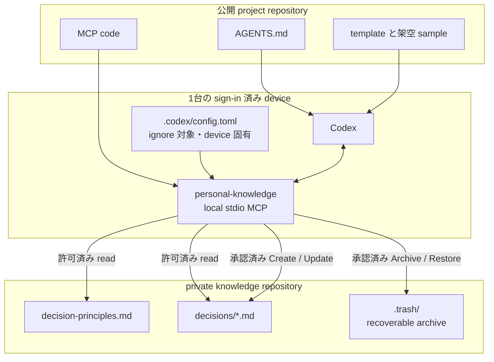
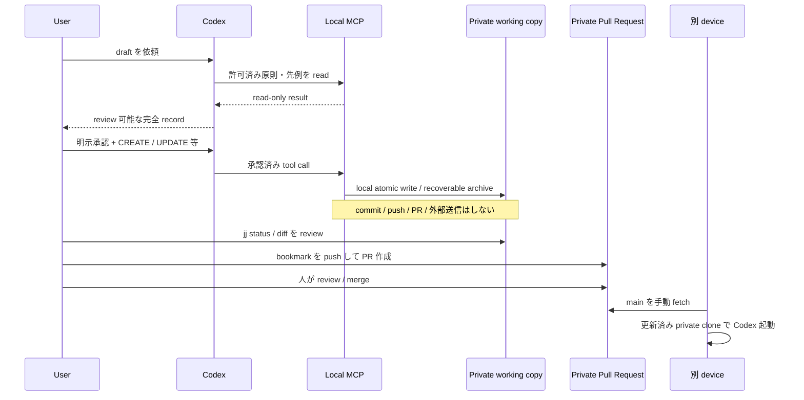

# 仕組みの概要

English: [overview.md](overview.md).

この project は、再利用する公開実装と、private な判断記録を分離します。公開 source repository を個人データの保管場所にせず、local の Codex session で判断支援を利用するための構成です。

## component と情報境界

MCP が扱えるのは設定済み private root だけです。root 外の path、無効な ID、許可 classification を超える record は拒否します。通常の server は `internal` までを返します。`confidential` record は、明示的に別設定した server でだけ扱います。

## record の変更は意図的に2段階です

MCP の confirmation は誤操作による書込みを防ぎ、JJ Pull Request review はどの record を他 device へ送るかを制御します。いずれも自動ではありません。

## どの操作がどの file を変えるか

| 操作 | file を変えるか | 場所 | 外部への影響 |
| --- | --- | --- | --- |
| `make onboard-status` | いいえ | なし | なし |
| MCP 起動 / read tool | いいえ | なし | なし |
| Create / Update | はい | `private-root/decisions/<id>.md` | なし |
| Archive | はい | record を `private-root/.trash/` へ移動 | なし |
| Restore | はい | 指定 archive を `decisions/` へ戻す | なし |
| JJ bookmark / PR / merge | user が実行した場合だけ | private Git repository | review 済み record を同期 |

最初は`make doctor`、続けて`make start`を使います。`make onboard`、`private-init`、`configure-mcp` は初期設定を直接操作するcommandです。empty private root や ignore された local configuration を作る場合があるため、設定済み device では意図があるときだけ再実行してください。

## 次に行うこと

1. 新しいdeviceでは、`make doctor`、次に`make start`を実行する。
2. `make mcp-status`を実行してから、project directory でCodexを起動する。
3. [架空 data の tutorial](tutorials.ja.md) から始める。
4. 実データを保存する前に、repository visibility、access、匿名化、classification、backup policy を確認する。
