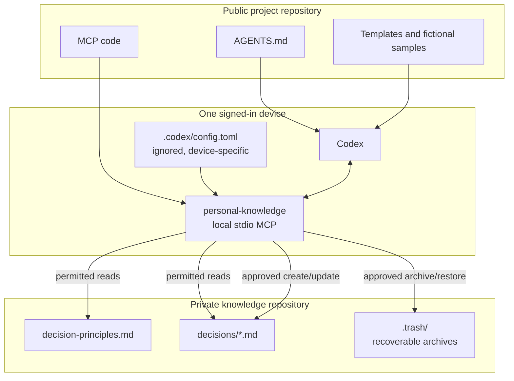
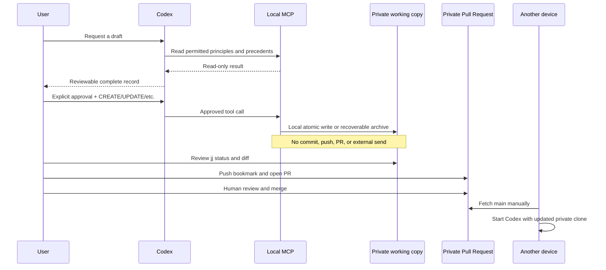

# Architecture overview

Japanese: [overview.ja.md](overview.ja.md).

This project separates reusable public implementation from private decision
knowledge. The separation keeps a local Codex session useful without treating
the public source repository as a personal-data store.

## Components and trust boundary

Only the configured private root is available to the MCP. It rejects paths
outside that root, invalid IDs, and records above the configured classification
limit. The normal server exposes at most `internal` records; a separate,
explicit confidential configuration is required for `confidential` records.

## A record change is intentionally two-stage

MCP confirmation prevents accidental writes; JJ Pull Request review controls
which reviewed records reach other devices. Neither stage is automatic.

## What changes which files?

| Action | Changes files? | Location | External effect? |
| --- | --- | --- | --- |
| `make onboard-status` | No | None | None |
| Start MCP / use read tools | No | None | None |
| Create or update | Yes | `private-root/decisions/<id>.md` | None |
| Archive | Yes | Moves a record to `private-root/.trash/` | None |
| Restore | Yes | Moves a chosen archive back to `decisions/` | None |
| JJ bookmark / PR / merge | Yes, only when the user runs it | Private Git repository | Synchronizes reviewed records |

Start with `make doctor` and `make start`. `make onboard`, `private-init`, and
`configure-mcp` are direct setup commands. They can create an empty private
root or an ignored local configuration, so do not rerun them on an already
configured device unless you intend that change.

## Next steps

1. On a new device, run `make doctor` and then `make start`.
2. Run `make mcp-status`, then open Codex from the project directory.
3. Start with [the fictional tutorial](tutorials.md).
4. Before storing real information, confirm repository visibility, access,
   anonymization, classification, and backup policy.
