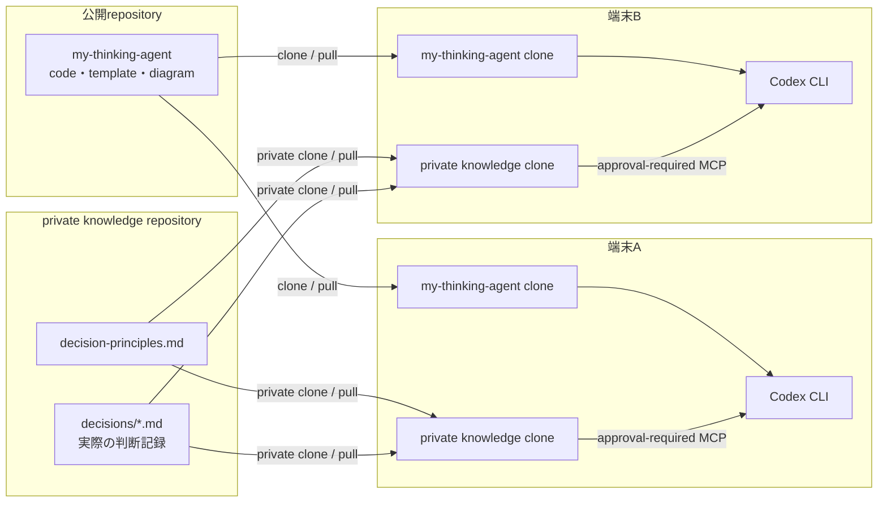
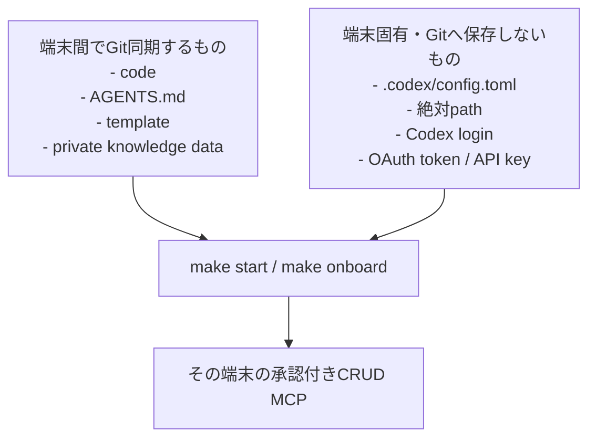
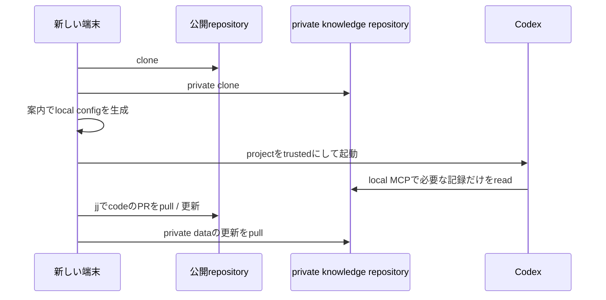

# 複数端末での利用と同期

English: [portable-setup.md](portable-setup.md).

このprojectは、公開してよい実装と、個人の判断記録を意図的に分離します。端末間の同期には、公開repositoryと**別のprivate knowledge repository**を使う構成を推奨します。

初めて試す場合は、架空dataで検索・CRUD・端末間同期を順に確認できる[実践tutorial](tutorials.ja.md)から始めてください。

初回設定や別端末への引継ぎを質問形式で行う場合は、`make start`を実行してください。private rootの作成、private repositoryのclone、新規repository作成、initial templateのPR作成を、対象確認付きで案内します。詳細は[対話的onboarding](onboarding.ja.md)を参照してください。

## 全体構成



公開repositoryにはcode、一般化したrule、架空sampleだけを置きます。実際の判断記録はprivate repositoryにだけ保存し、MCPは各端末のprivate cloneを読み取ります。

## 端末ごとに異なるもの



各端末で必要なのは次の4つです。

- Git、jj、Python 3.11以上、uv、Codex CLI
- 公開repositoryのclone
- private knowledge repositoryのclone
- その端末の絶対pathを記録した .codex/config.toml

Codexのproject設定はtrusted projectの .codex/config.toml に置けますが、device固有のpathやcredentialを含み得るためcommitしません。

## private knowledge repositoryは必要か

`my-thinking-agent-private` は、実際の判断原則と判断記録を入れる**別のprivate repositoryの推奨名**です。公開projectの実装repositoryではありません。必要性は用途で変わります。

| 用途 | private knowledge repository | 理由 |
| --- | --- | --- |
| 架空sampleだけを読む・tutorialを試す | 不要 | 公開project内のsampleだけで確認できる |
| 実際のrecordを1台だけで扱い、Git同期しない | 任意 | Git remoteなしのlocal directoryをprivate rootにできる |
| 実際のrecordを複数端末で利用する | 必要 | 各端末のprivate cloneをJJ Pull Requestで同期するため |

実際の判断原則を公開projectの`knowledge/decision-principles.md`へ書かないでください。このfileはimplementationのsampleとして追跡されます。実データにはexternal private rootを使います。private repositoryは「publicではない」だけで、暗号化された保管領域そのものではありません。

### 単一端末だけで始める場合

GitHub repositoryは作らず、emptyなlocal directoryをprivate rootとして初期化できます。この場合、ほかの端末には同期されません。案内を使うとpathを含む長いcommandを覚える必要がありません。

```bash
git clone https://github.com/kazunari-kamata/my-thinking-agent.git ~/my-thinking-agent
cd ~/my-thinking-agent
make start
```

案内では`1`を選びます。

### 複数端末で使うprivate repositoryを新規作成する場合

すでにprivate repositoryがある場合は、次の作成手順を飛ばして「既存のprivate repositoryを使う場合」へ進みます。新規作成は、対象確認付きの案内で行えます。

```bash
git clone https://github.com/kazunari-kamata/my-thinking-agent.git ~/my-thinking-agent
cd ~/my-thinking-agent
make onboard
```

案内では`3`を選びます。directory、GitHub repository、push対象を表示してから完全一致confirmationを求めます。`gh`のログインaccountに同名repositoryがある場合は、別名を選ぶか、既存repositoryを使ってください。`my-thinking-agent-private`という名前自体は必須ではありません。

### 既存のprivate repositoryを使う場合

private Git remoteは、利用者が管理するprivate GitHub repositoryなどを使います。案内でURLを入力して接続します。

```bash
git clone https://github.com/kazunari-kamata/my-thinking-agent.git ~/my-thinking-agent
cd ~/my-thinking-agent
make start
```

案内では`2`を選び、既存private repositoryのURLを入力します。案内はclone前に確認を求めます。既存のfileと`.codex/config.toml`は上書きしません。公開projectの[private repository template](../templates/my-thinking-agent-private/)と同じデータなしの構成を作成する場合も、対象確認を求めます。

```bash
cd ~/my-thinking-agent-private
jj status
jj describe -m "knowledge: initialize private knowledge root"
jj bookmark create setup/private-knowledge -r @
jj git push --bookmark setup/private-knowledge
gh pr create --base main --head setup/private-knowledge \
  --title "knowledge: private knowledge rootを初期化"
```

private repositoryへ最初の判断記録を入れる前に、private visibility、アクセス可能なaccount、backup policyを確認してください。private repositoryは「publicではない」だけで、暗号化された保管領域そのものではありません。より強い保護が必要なら、端末のdisk encryptionと別途暗号化したbackupを併用してください。

## 2台目以降の端末を設定する



```bash
git clone https://github.com/kazunari-kamata/my-thinking-agent.git ~/my-thinking-agent
cd ~/my-thinking-agent
make start
```

案内では`2`を選びます。`make mcp-status`を実行し、personal-knowledge と有効toolを確認してからCodexを起動します。設定生成後は、端末ごとにCodexへloginし、projectをtrustedにする操作が必要です。

## 日常の同期手順

1. 公開repositoryでは、jj bookmarkからPull Requestを作成し、mainをpullする。
2. private knowledge repositoryでは、判断記録をpullしてから編集する。
3. private repositoryへ保存する前に、classificationと匿名化を確認する。
4. もう一方の端末では、private repositoryをpullしてからCodexを起動する。

MCP serverはprivate clone内で承認付きのCreate / Update / Archive / Restoreを行えますが、Git commit、push、Pull Request、外部送信、公開、完全消去は行いません。recordのCRUDと同期手順は[判断記録のCRUDと同期](crud-operations.ja.md)を参照してください。

MCP・JJ・program sourceのどの更新も、このprojectではschedule実行や自動同期を設定しません。更新する範囲別の手順と必要な設定は[更新・同期・設定](update-operations.ja.md)を参照してください。

## 端末上の確認

```bash
cd ~/my-thinking-agent
make test
make status
```

`make status`はlocalの生成済み設定、登録済みsource pathと利用可否、CodexへのMCP登録状態と有効toolをまとめて表示します。

MCP toolが扱うのは、設定されたprivate root内のdecision-principles.mdとdecisions/だけです。absolute path、token、credentialをpromptやversion control対象のfileに書かないでください。
