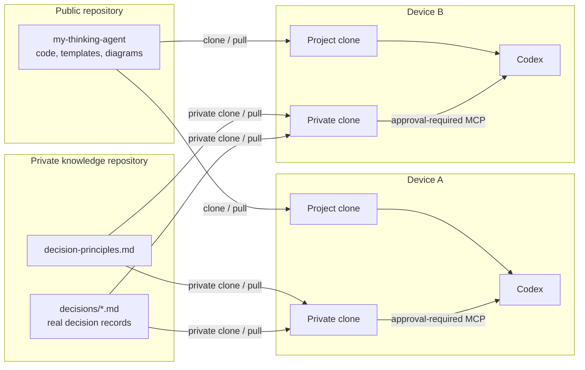

# Portable setup and multi-device synchronization

Japanese: [portable-setup.ja.md](portable-setup.ja.md).

Keep reusable implementation public and real decision records private. Use a
separate private knowledge repository when records must be synchronized across
devices. New users should begin with the fictional [tutorial](tutorials.md), or
run `make start` for guided setup.

## Architecture



Public source contains code, generalized rules, and fictional samples only.
Private data is read from each device's private clone.

## Per-device items

Each device needs Git, JJ, Python 3.11+, uv, Codex CLI, a public project clone,
a private knowledge clone when applicable, and an ignored `.codex/config.toml`
containing that device's absolute paths. Do not commit the local Codex
configuration, credentials, or paths.

## Is a private knowledge repository needed?

| Use | Private repository | Why |
| --- | --- | --- |
| Read fictional samples or run the tutorial | Not needed | Public samples are sufficient |
| Use real records on one device without Git synchronization | Optional | An untracked local directory can be the private root |
| Use real records on multiple devices | Needed | Review and synchronize private clones with JJ Pull Requests |

Do not put real principles in the public `knowledge/decision-principles.md`.
A private repository is not encryption by itself; confirm repository visibility,
access, disk encryption, and backup policy before storing real records.

## One-device setup

For one computer, run the guide. It can initialize an empty local private
directory without creating a GitHub repository:

```bash
git clone https://github.com/kazunari-kamata/my-thinking-agent.git ~/my-thinking-agent
cd ~/my-thinking-agent
make start
```

Choose option `1`.

## New private repository for multiple devices

Use the guided setup rather than creating the repository by hand:

```bash
git clone https://github.com/kazunari-kamata/my-thinking-agent.git ~/my-thinking-agent
cd ~/my-thinking-agent
make onboard
```

Choose option `3`. It displays the target directory and GitHub repository, then
asks for exact confirmation before it creates or pushes anything.

## Connect an existing private repository

```bash
git clone https://github.com/kazunari-kamata/my-thinking-agent.git ~/my-thinking-agent
cd ~/my-thinking-agent
make start
```

Choose option `2` and enter the existing private-repository URL. The guide
asks before cloning it to this device.

The guide refuses to overwrite an existing private root or hand-written local
configuration. If it initializes a new root, review its template and send it to
the private remote through a JJ Pull Request before adding real records.

## Configure another device

```bash
git clone https://github.com/kazunari-kamata/my-thinking-agent.git ~/my-thinking-agent
cd ~/my-thinking-agent
make start
```

Choose option `2`, then trust the project, run `make mcp-status`, and start
`codex`. Each device must log in to Codex and create its own local
configuration.

The guide initializes only an empty private root and never overwrites existing
files or `.codex/config.toml`. It creates the data-free
[private-repository template](../templates/my-thinking-agent-private/) layout;
review that layout and synchronize it through a private-repository JJ Pull
Request before adding real records.

## Day-to-day synchronization

1. Update public code through a JJ Pull Request and pull its merged `main`.
2. Fetch the private repository before editing a record.
3. Review classification and anonymization before a private record is committed.
4. Push a private JJ bookmark, open/review/merge its PR, then fetch `main` on
   the other device before opening Codex.

MCP does not schedule, auto-pull, auto-push, publish, or permanently delete.
Use [CRUD and synchronization](crud-operations.md) and [update operations](update-operations.md)
for exact workflows.

## Verify locally

```bash
cd ~/my-thinking-agent
make test
make status
```

`make status` displays the local generated configuration, configured source
paths and availability, plus Codex's MCP-registration state and enabled tools.
