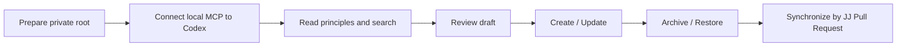

# Tutorial: exercise the complete flow with fictional records

Japanese: [tutorials.ja.md](tutorials.ja.md).

This tutorial uses no personal data, customer data, or real decisions. It uses
the public [fictional project-priority sample](../examples/tutorial-project-priority.md).



When moving to real records, do not reuse fictional wording unchanged. Review
anonymization, classification, and the sharing boundary first.

## 0. Boundary and terminology

| Location | Stores | Git treatment |
| --- | --- | --- |
| `my-thinking-agent` | Code, templates, fictional samples, documentation | Public-safe material only |
| Private knowledge repository | Real principles and records | Private repository only |
| `.codex/config.toml` | Absolute paths for this device | Never commit |

MCP changes only the private clone on this device. It never commits, pushes,
opens PRs, sends data externally, or permanently deletes. Create, update,
archive, and restore each require tool approval and an exact confirmation.

## 1. Initial setup

Install Python 3.11+, uv, Codex CLI, Git, and JJ. For a multi-device real-data
setup, use onboarding choice 2 or 3. For this fictional tutorial, choice 1 is
enough and creates a private folder only on this computer.

```bash
git clone https://github.com/kazunari-kamata/my-thinking-agent.git ~/my-thinking-agent
cd ~/my-thinking-agent
make start
make test
```

In the guide, choose `1` for this tutorial. On another device where you already
have a private repository, choose `2` instead. The guide shows what it will do
before it creates or connects anything.

Run `make mcp-status` to verify `personal-knowledge` and its enabled tools,
then start Codex from the project.

```bash
cd ~/my-thinking-agent
make mcp-status
codex
```

## 2. Read principles and precedents

In Codex, request a read-only search:

```text
Use personal-knowledge. Read the decision principles, then search for “reversibility approval”. Show only record ID, classification, and summary in a table. Do not recommend or modify files.
```

`search_decisions` returns metadata and a bounded summary. Ask for
`read_decision` only after identifying a relevant record, and state both where
the precedent applies and where it does not.

## 3. Create a fictional record after review

Ask for a complete draft in the format of the fictional sample, including front
matter, facts, assumptions, options, decision, and summary. Do not combine the
draft request with storage approval.

```text
Show a complete draft for tutorial-project-priority using the sample format. Do not save it. Check that required front matter and all sections are present.
```

After review:

```text
I reviewed the content and approve saving it to private knowledge.
CREATE tutorial-project-priority
```

The active record is created only in this device's private clone; another device
does not receive it yet.

## 4. Update with a complete revised record

Ask to display the entire revised record, not a patch. Once reviewed:

```text
I reviewed the complete revision and approve the update.
UPDATE tutorial-project-priority
```

The server atomically replaces only the record with the same ID. It rejects an
ID change, a missing record, or a classification-boundary violation.

## 5. Archive and restore

```text
Show the target, reason, and restoration method for archiving tutorial-project-priority. Do not archive it yet.

I approve the archive.
ARCHIVE tutorial-project-priority
```

Then ask `list_archived_decisions` for the `archive_id`, review it, and approve:

```text
RESTORE tutorial-project-priority
```

Restore fails rather than overwriting an already active record. For precise tool
arguments see [MCP tool call examples](../examples/mcp-tool-calls.md).

## 6. Synchronize to another device

```bash
cd ~/my-thinking-agent-private
jj status
jj describe -m "knowledge: add tutorial project priority"
jj bookmark create knowledge/tutorial-project-priority -r @
jj git push --bookmark knowledge/tutorial-project-priority
gh pr create --base main --head knowledge/tutorial-project-priority \
  --title "knowledge: add fictional project-priority record"
```

Review and merge the PR. On the other device, fetch private `main` before
starting Codex. Never edit the same record on two devices at once; resolve and
review conflicts manually before a later MCP write.

## 7. Before using real data

1. Confirm private-repository visibility and access.
2. Remove personal data, customer names, credentials, and unnecessary source text.
3. Set an appropriate classification; the normal server returns only up to `internal`.
4. Keep external sends, spending, contracts, and permanent deletion outside MCP.
5. Review the whole record and give the exact operation confirmation.
