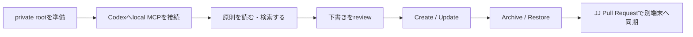
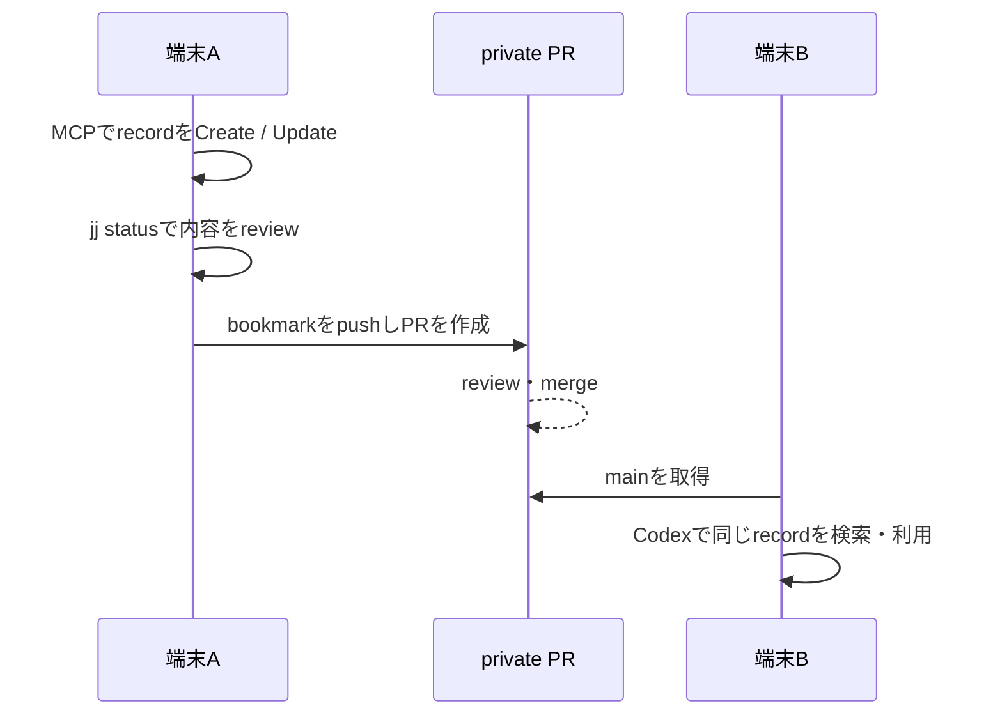

# tutorial: 架空の判断記録で一連の利用を試す

このtutorialでは、個人情報・顧客情報・実際の判断を使いません。公開repositoryの[架空sample](../examples/tutorial-project-priority.md)を題材に、Codex CLIとlocal MCPで次の流れを一度通します。



実際のrecordを使う段階では、sampleの文章をそのまま流用せず、匿名化・classification・共有範囲を確認してください。

## 0. 用語と安全境界

| 場所 | 保存するもの | Gitの扱い |
| --- | --- | --- |
| `my-thinking-agent` | code、template、架空sample、document | publicでもよいものだけ |
| private knowledge repository | 実際の判断原則と判断記録 | private repositoryだけ |
| `.codex/config.toml` | この端末の絶対path | Gitへ保存しない |

MCPが行うのは現在の端末のprivate cloneへの変更までです。Git commit、push、Pull Request、外部送信、完全消去は行いません。作成・更新・archive・復元には、Codex側のtool approvalと、`CREATE <id>`などの完全一致confirmationが両方必要です。

## 1. 初回設定

Python 3.11以上、`uv`、Codex CLI、Git、jjを用意します。架空sampleだけを試すならprivate repositoryは不要です。実際のrecordを複数端末で使う場合は、`make onboard`の選択肢2または3を使うと、private repositoryのclone・作成とlocal config生成を質問形式で行えます。[private knowledge repositoryが必要な場合の作成・選択手順](portable-setup.md#private-knowledge-repositoryは必要か)と[対話的onboarding](onboarding.md)も参照してください。`PRIVATE_REPO_URL`は利用者自身のprivate repository URLへ置き換えます。

```bash
git clone https://github.com/kazunari-kamata/my-thinking-agent.git ~/my-thinking-agent
git clone <PRIVATE_REPO_URL> ~/my-thinking-agent-private

cd ~/my-thinking-agent
uv sync
uv run --directory "$PWD" python -m my_thinking_agent.bootstrap \
  --knowledge-root ~/my-thinking-agent-private \
  --initialize-knowledge-root \
  --write-project-config
make test
```

`--initialize-knowledge-root`はemptyなprivate cloneだけを初期化します。すでに`decision-principles.md`と`decisions/`がある2台目以降では、このoptionを外します。

```bash
cd ~/my-thinking-agent
uv run --directory "$PWD" python -m my_thinking_agent.bootstrap \
  --knowledge-root ~/my-thinking-agent-private \
  --write-project-config
```

`.codex/config.toml`は端末固有のpathを持つため、commitしません。Codexでこのprojectをtrustedにしてから起動し、`/mcp`で`personal-knowledge`が表示されることを確認します。

```bash
cd ~/my-thinking-agent
codex
```

MCP configurationはCodex CLI、IDE extension、desktop appで同じCodex host上なら共有されます。ただし、このtutorialのserverはlocal stdio processなので、別端末ではそれぞれprivate cloneとlocal configurationが必要です。[公式のCodex MCP document](https://learn.chatgpt.com/docs/extend/mcp)も参照してください。

## 2. 読む: 判断原則と先例を検索する

Codex sessionで次を入力します。

```text
personal-knowledgeを使い、まず判断原則を読んでください。
次に「可逆性 承認」で判断記録を検索し、各結果についてrecord ID、分類、要約だけを表で示してください。
推奨はまだ出さず、fileも変更しないでください。
```

`search_decisions`は全文ではなくID・metadata・要約を返します。詳細が必要な場合だけ、次のように`read_decision`を使わせます。

```text
example-reversible-automation を読んでください。
この先例が今回の判断に使える範囲と、使えない範囲を分けて説明してください。
fileは変更しないでください。
```

## 3. 作る: 架空recordをreviewしてから保存する

まず下書きだけを表示します。Createの依頼と保存承認を一つにせず、内容を確認できる会話を挟みます。

```text
[examples/tutorial-project-priority.md]と同じformatで、
tutorial-project-priority という架空の判断記録の完全な下書きを表示してください。
保存はしないでください。front matterと、事実・仮定・選択肢・判断・要約が揃っているか自己確認してください。
```

表示内容が[架空sample](../examples/tutorial-project-priority.md)と同じであることを確認したら、同じ会話で承認します。

```text
内容を確認しました。private knowledgeへの保存を承認します。
CREATE tutorial-project-priority
```

作成に成功すると、private cloneの`decisions/tutorial-project-priority.md`が追加されます。この時点では別端末へは未同期です。

## 4. 更新する: 結果を追記した完全版をreviewする

このMCPは部分patchを受け付けません。front matterを含む更新後のrecord全体を一度表示し、reviewしてから置換します。

```text
tutorial-project-priority の現在内容を読み、次の架空の結果を反映した完全版を表示してください。

- 候補Aの利用者影響が確認できた。
- 候補Bの削減効果は追加測定が必要だった。

まだ更新しないでください。
```

正しい内容になったら、次を送ります。

```text
内容を確認しました。更新を承認します。
UPDATE tutorial-project-priority
```

MCPは同じIDのrecordだけをatomicに置換します。ID変更、存在しないrecordへのUpdate、または分類境界を越える変更は拒否されます。

## 5. archiveして復元する

不要になった架空recordは、完全消去ではなく`.trash`へ移動できます。

```text
tutorial-project-priority をarchiveする対象・理由・復元方法を表示してください。
まだarchiveしないでください。
```

確認後に次を送ります。

```text
内容を確認しました。archiveを承認します。
ARCHIVE tutorial-project-priority
```

復元時は、先にarchive一覧を取得します。

```text
archive済みの判断記録を一覧にしてください。tutorial-project-priority の archive_id を示してください。
```

表示された`archive_id`を確認後、復元を承認します。

```text
そのarchive_idのrecordを復元することを承認します。
RESTORE tutorial-project-priority
```

active recordが既にある場合は、誤って上書きしないよう復元が失敗します。詳細なtool引数は[tool呼び出し例](../examples/mcp-tool-calls.md)、CRUD仕様は[判断記録のCRUDと同期](crud-operations.md)を参照してください。

## 6. 別端末でも使える状態へ同期する

MCP変更後、private cloneのdiffを確認し、private repositoryでJJ Pull Requestを作成します。実際に同期したいrecordだけをreviewして含めてください。

```bash
cd ~/my-thinking-agent-private
jj status
jj describe -m "knowledge: add tutorial project priority"
jj bookmark create knowledge/tutorial-project-priority -r @
jj git push --bookmark knowledge/tutorial-project-priority
gh pr create --base main --head knowledge/tutorial-project-priority \
  --title "knowledge: 架空の優先順位判断recordを追加"
```

Pull Requestをreview・mergeした後、別端末ではprivate repositoryのmainを取得してからCodexを起動します。public projectの更新も同様にJJ Pull Request経由で取り込みます。

この同期は自動ではありません。端末ごとの更新command、MCP configurationの更新条件、auto-updateを設定しない理由は[更新・同期・設定](update-operations.md)を参照してください。



同じrecordを複数端末で同時編集しないでください。競合がある場合は、Git/JJ上で人が内容をreview・解決してから、MCPで次の変更を行います。

## 7. 実データへ移る前の確認

1. private repositoryのvisibilityとアクセス権を確認したか。
2. recordから個人情報、顧客名、credential、不要な原文を外したか。
3. `classification`が適切か。通常のserverは`internal`までを返す。
4. 外部送信・支出・契約・完全削除をMCPに任せていないか。
5. record全体をreviewし、変更ごとのconfirmationを明示したか。

この確認を通過した匿名化済みのrecordから、少数ずつprivate knowledgeへ追加してください。
