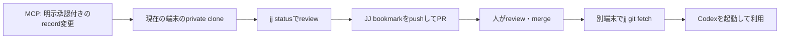

# 更新・同期・設定

English: [update-operations.md](update-operations.md).

このprojectに**自動で判断記録を変更・同期・公開する機能はありません**。MCPは明示的なtool callを受けた現在の端末だけを変更し、Git/JJ・GitHub・別端末への反映は利用者がreviewして実行します。



## 何が更新されるか

| 更新対象 | 自動か | 必要な設定 | 反映範囲 |
| --- | --- | --- | --- |
| 判断recordのCreate / Update / Archive / Restore | いいえ。tool approvalと完全一致confirmationが必要 | private rootへ接続する`.codex/config.toml` | 現在の端末のprivate cloneだけ |
| private knowledgeの別端末への同期 | いいえ。PRのreview・mergeと各端末のfetchが必要 | private Git remote、GitHub認証、JJ | merge後に取得した端末 |
| `my-thinking-agent`のcode / document更新 | いいえ。public projectのPRをmerge後に取得 | public repositoryのcloneとJJ | 取得した端末 |
| `.codex/config.toml`のMCP設定 | いいえ。端末ごとに案内で生成・更新 | absolute path、trusted project | 設定した端末だけ |
| Python environment | いいえ。documentされたproject更新手順を実行 | Python 3.11以上 | 実行した端末だけ |

したがって、cron、常駐process、GitHub Actions、auto-pull、auto-pushを設定する必要はありません。実際の判断記録は変更内容を確認してから同期する設計です。

初回設定・別端末へのprivate clone・new private repositoryの作成は、質問形式の`make start`で始められます。設定の選択肢を直接開きたい場合は`make onboard`です。これはrecordの更新や同期を自動化するものではありません。詳細は[対話的onboarding](onboarding.ja.md)を参照してください。

## 初回に端末ごと必要な設定

private knowledgeを使う端末では、次を一度だけ行います。

1. public projectをcloneする。
2. public projectで案内を実行し、必要ならprivate knowledge repositoryをcloneまたは作成する。
3. 案内がこの端末のprivate rootのabsolute pathを持つ`.codex/config.toml`を生成する。
4. Codexでprojectをtrustedにし、`make mcp-status`で`personal-knowledge`と有効toolを確認してから起動する。

```bash
cd ~/my-thinking-agent
make start
```

`default_tools_approval_mode = "approve"`と操作ごとの`CREATE <id>`などのconfirmationは、安全のため維持します。自動化のために緩和する設定はありません。

## 判断recordを更新して別端末へ反映する

### 1. 現在の端末でMCP更新を行う

Codexに変更案を表示させ、内容をreviewした後に同じ会話で承認します。

```text
内容を確認しました。更新を承認します。
UPDATE vendor-selection-2026-01
```

これは現在のprivate cloneの`decisions/`だけを更新します。ほかの端末、GitHub、外部serviceにはまだ反映されません。

### 2. private repositoryのPRを作る

変更内容を確認し、bookmarkをpushしてPull Requestを作ります。`jj bookmark set`は新規作成と既存bookmarkの更新の両方に使えます。

```bash
cd ~/my-thinking-agent-private
jj status
jj diff
jj describe -m "knowledge: update vendor selection record"
jj bookmark set knowledge/vendor-selection -r @
jj git push --bookmark knowledge/vendor-selection
gh pr create --base main --head knowledge/vendor-selection \
  --title "knowledge: 委託先選定recordを更新"
```

Pull Requestをreview・mergeするまでは、他端末へ反映されません。MCPはGit commit、push、PR作成を行いません。

### 3. 別端末で受け取る

作業中の変更がないことを`jj status`で確認してから、remoteの`main`を取得します。

```bash
cd ~/my-thinking-agent-private
jj status
jj git fetch --remote origin
jj log -r main@origin
jj new main@origin
jj status
```

`jj new main@origin`は、取得済みの`main`を親にした新しい空のworking-copy changeへ移動し、fileをその状態にします。作業中のrecordがある場合は先にPRへ送るか、別のchangeとして保持してから実行してください。競合が表示された場合は、人が内容をreviewして解決するまでMCPでrecordを更新しません。

## program本体を更新する

公開projectのPull Requestがmergeされた後、各端末でsourceを取得し、dependencyとMCPを確認します。

```bash
cd ~/my-thinking-agent
jj status
jj git fetch --remote origin
jj log -r main@origin
jj new main@origin
uv sync
make test
```

MCP toolの一覧やgenerated configurationが変更されたreleaseでは、案内が生成したconfigだけを安全に更新できます。

```bash
cd ~/my-thinking-agent
make update-mcp
```

手書きの`.codex/config.toml`は上書きされません。`config/codex-mcp-config.toml.example`と比較して必要な差分を手動で反映し、`make mcp-status`を実行してからCodexを再起動してください。会話学習で参照する名前付きlocal workspace rootを追加・更新する場合は、`make learning-add SOURCE=NAME=PATH`を使います。relative pathはproject root基準で解決され、absolute pathとして保存されます。`make learning-sources`で名前と利用可否を表示し、1件の削除は`make learning-remove SOURCE=NAME`です。既存sourceは削除しない限り維持され、全置換は完全な一覧と`--replace-learning-sources`を指定した場合だけです。pathはこの端末のignoreされた設定だけに残ります。詳細は[会話からの学習](conversation-learning.ja.md)を参照してください。

## 更新頻度の目安

- 判断record: 判断が変わったときだけ。毎回、完全なrecordをreviewして明示承認する。
- private knowledgeの同期: 別端末で使う前、またはreview・merge後に手動で行う。
- program本体: 必要な修正・新機能がmergeされたときに手動で行う。
- MCP設定: private rootのpath変更、tool一覧の変更、別端末追加のときだけ行う。

自動更新は利便性を上げますが、未reviewの判断記録を別端末へ広げたり、想定外のconfigurationを有効化したりするおそれがあります。このprojectでは、更新箇所と承認者が分かる手動のJJ Pull Request workflowを標準とします。
