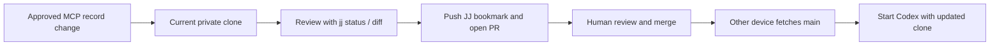

# Updates, synchronization, and configuration

Japanese: [update-operations.ja.md](update-operations.ja.md).

This project does **not** automatically change, synchronize, or publish decision
records. MCP changes only the current device after an explicit tool call; Git/JJ,
GitHub, and other devices change only after human review and action.



## What is updated?

| Target | Automatic? | Required setup | Scope |
| --- | --- | --- | --- |
| Create / Update / Archive / Restore a record | No; approval and exact confirmation required | `.codex/config.toml` connected to private root | Current private clone only |
| Private-data synchronization | No; PR review/merge and fetch required | Private Git remote, GitHub authentication, JJ | Devices that fetch after merge |
| Public code and documentation | No; pull merged public PR | Public clone and JJ | Device where pulled |
| Local MCP configuration | No; guided setup per device | Absolute paths and trusted project | Configured device only |
| Python environment | No; follow the documented project-update instructions | Python 3.11+ | Device where run |

There is no cron job, daemon, GitHub Action, auto-pull, or auto-push for
decision records. This makes every synchronization reviewable.

## Initial device setup

For each device, clone the public project, then use the guided setup to connect
or create private knowledge as needed. It creates local configuration and shows
confirmation before material changes. Run `make mcp-status` to verify the
result.

```bash
cd ~/my-thinking-agent
make start
```

Keep `default_tools_approval_mode = "approve"` and the operation-specific
confirmations. There is no supported configuration that relaxes them for
automation.

## Change a record and distribute it

1. Ask Codex for a complete draft, review it, then explicitly approve the
   exact `UPDATE <id>` or other operation. Only the current private clone changes.
2. Review the private diff, describe the change, push a JJ bookmark, and open a
   Pull Request.
3. After review/merge, fetch the private main on each other device.

```bash
cd ~/my-thinking-agent-private
jj status
jj diff
jj describe -m "knowledge: update vendor selection record"
jj bookmark set knowledge/vendor-selection -r @
jj git push --bookmark knowledge/vendor-selection
gh pr create --base main --head knowledge/vendor-selection \
  --title "knowledge: update vendor-selection record"
```

On another device, ensure there is no unfinished work, then synchronize:

```bash
cd ~/my-thinking-agent-private
jj status
jj git fetch --remote origin
jj log -r main@origin
jj new main@origin
jj status
```

If a conflict appears, a person must resolve and review it before MCP makes a
further record change.

## Update the public project

After a public Pull Request is merged:

```bash
cd ~/my-thinking-agent
jj status
jj git fetch --remote origin
jj log -r main@origin
jj new main@origin
uv sync
make test
```

If an MCP-tool list or generated configuration changed, update only a
guided-setup-generated config:

```bash
cd ~/my-thinking-agent
make update-mcp
```

Hand-written `.codex/config.toml` is never overwritten. Compare it with the
example, make intentional changes, run `make mcp-status`, and restart Codex.

To add or update a named local workspace root used for conversation learning,
use `make learning-add SOURCE=NAME=PATH`; relative paths are resolved from the
project root and saved as absolute paths. Use `make learning-sources` to view
names and availability, and `make learning-remove SOURCE=NAME` to remove one.
Existing names remain unless removed; use `--replace-learning-sources` only
with a complete replacement list. The paths remain in this device's ignored
configuration. See
[conversation-derived learning](conversation-learning.md).

## Suggested cadence

- Records: only when the underlying decision changes; always review the full record.
- Private synchronization: before another device needs the record, or after review/merge.
- Program source: when a required fix or feature has merged.
- MCP configuration: only when the private-root path, available tools, or device changes.

Manual JJ Pull Request workflow is the default because automatic updates could
spread unreviewed records or enable unexpected configuration.
